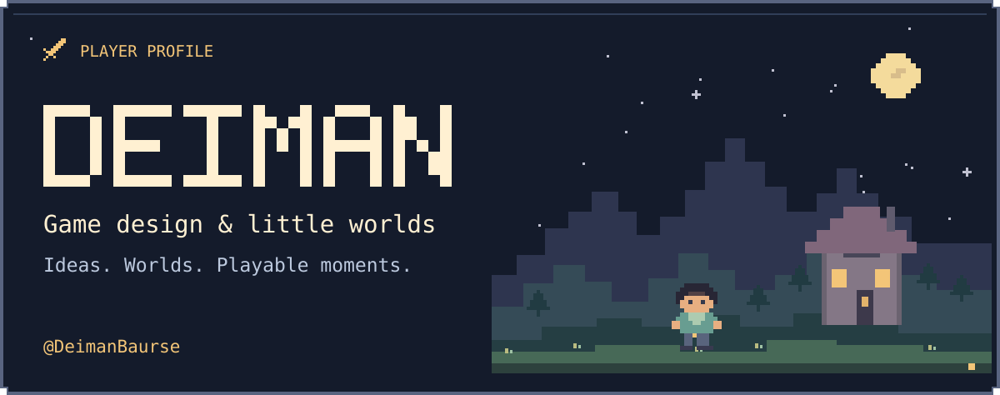
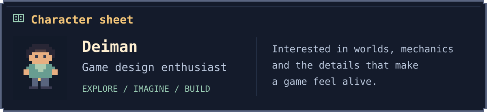
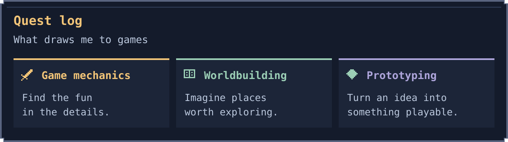
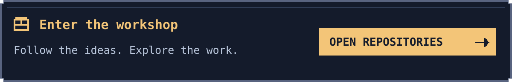

<picture>
  <source media="(max-width: 600px)" srcset="./assets/hero-mobile.svg">
  
</picture>

<picture>
  <source media="(max-width: 600px)" srcset="./assets/character-mobile.svg">
  
</picture>

<picture>
  <source media="(max-width: 600px)" srcset="./assets/quests-mobile.svg">
  
</picture>

<a href="https://github.com/DeimanBaurse?tab=repositories">
<picture>
  <source media="(max-width: 600px)" srcset="./assets/workshop-mobile.svg">
  
</picture>
</a>

  <a href="https://github.com/DeimanBaurse?tab=repositories">All repositories</a>
  &nbsp; / &nbsp;
  <a href="https://github.com/DeimanBaurse/DeimanBaurse">Behind this profile</a>

