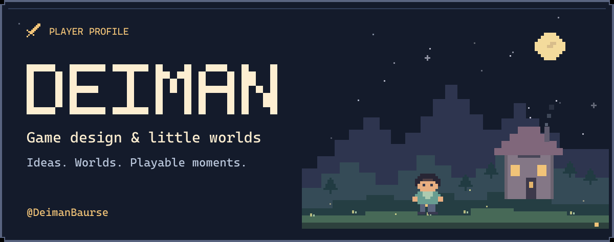
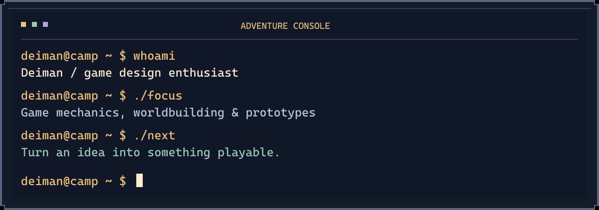
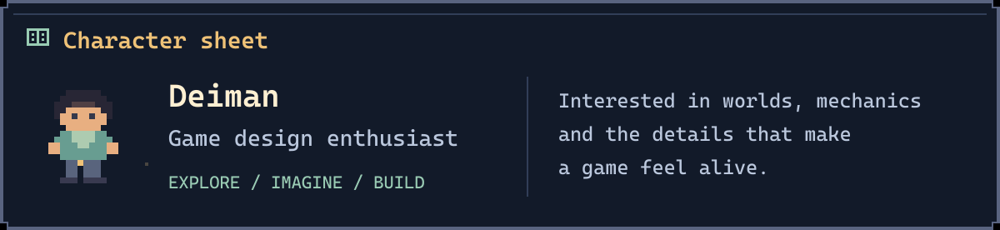
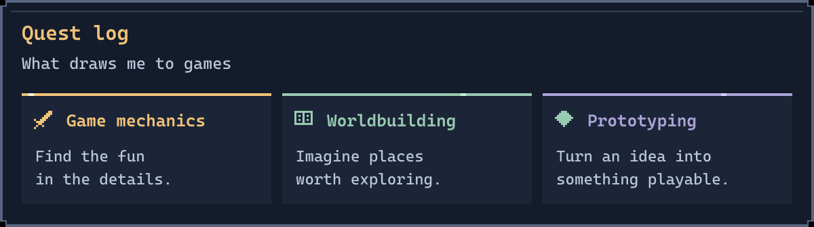
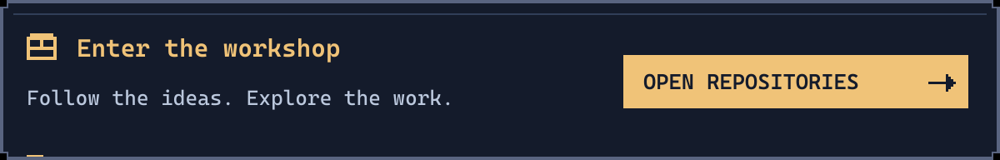

<a href="https://github.com/DeimanBaurse"><picture><source media="(prefers-reduced-motion: reduce)" srcset="./assets/lang-en-active.svg"></picture></a>
&nbsp;
<a href="./README.tr.md"><picture><source media="(prefers-reduced-motion: reduce)" srcset="./assets/lang-tr-link.svg"></picture></a>

<picture>
  <source media="(max-width: 600px) and (prefers-reduced-motion: reduce)" srcset="./assets/hero-mobile.svg">
  <source media="(prefers-reduced-motion: reduce)" srcset="./assets/hero.svg">
  <source media="(max-width: 600px)" srcset="./assets/hero-mobile.gif">
  
</picture>

<picture>
  <source media="(max-width: 600px) and (prefers-reduced-motion: reduce)" srcset="./assets/terminal-mobile.svg">
  <source media="(prefers-reduced-motion: reduce)" srcset="./assets/terminal.svg">
  <source media="(max-width: 600px)" srcset="./assets/terminal-mobile.gif">
  
</picture>

<picture>
  <source media="(max-width: 600px) and (prefers-reduced-motion: reduce)" srcset="./assets/character-mobile.svg">
  <source media="(prefers-reduced-motion: reduce)" srcset="./assets/character.svg">
  <source media="(max-width: 600px)" srcset="./assets/character-mobile.gif">
  
</picture>

<picture>
  <source media="(max-width: 600px) and (prefers-reduced-motion: reduce)" srcset="./assets/quests-mobile.svg">
  <source media="(prefers-reduced-motion: reduce)" srcset="./assets/quests.svg">
  <source media="(max-width: 600px)" srcset="./assets/quests-mobile.gif">
  
</picture>

<a href="https://github.com/DeimanBaurse?tab=repositories">
<picture>
  <source media="(max-width: 600px) and (prefers-reduced-motion: reduce)" srcset="./assets/workshop-mobile.svg">
  <source media="(prefers-reduced-motion: reduce)" srcset="./assets/workshop.svg">
  <source media="(max-width: 600px)" srcset="./assets/workshop-mobile.gif">
  
</picture>
</a>

<a href="https://github.com/DeimanBaurse?tab=repositories">All repositories</a> &nbsp; / &nbsp; <a href="https://github.com/DeimanBaurse/DeimanBaurse">Behind this profile</a>

